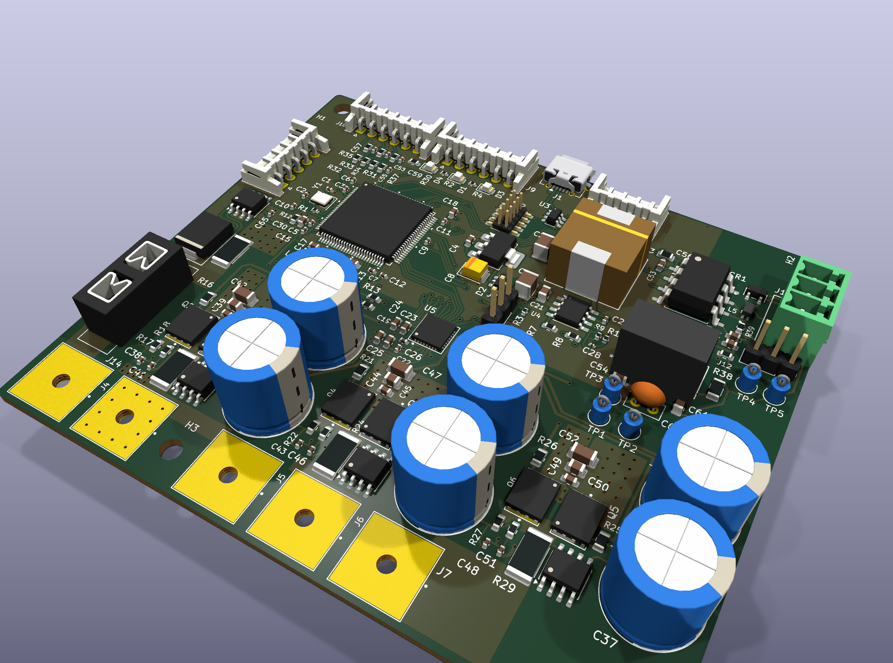
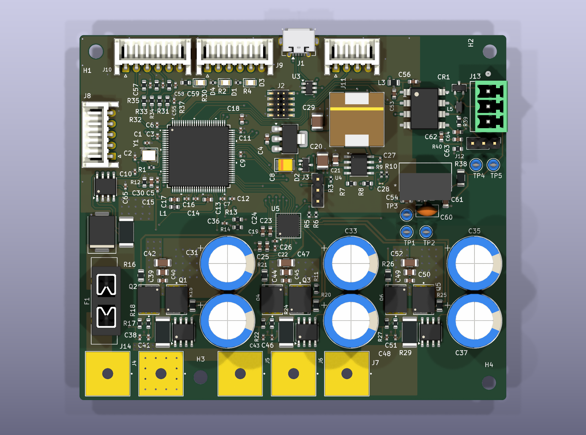

# Motor-Control

KiCad hardware design for a three-phase BLDC motor drive, built around an STM32G473 microcontroller and a DRV8350S gate driver.

> **Status:** version 0.2. The schematic is finished (ERC: 0 errors) and the PCB is placed and routed (DRC: 0 errors, 0 unconnected items). No board has been built or tested yet. See [Known issues and open items](#known-issues-and-open-items).

## Hardware overview

| Block | Parts | Notes |
|---|---|---|
| MCU | STM32G473VET6 | LQFP100, 24 MHz crystal |
| Gate driver | DRV8350S | SPI interface and enable line to the MCU; nFAULT goes to the TIM8 break input |
| Power stage | 6 × BSC070N10NS5SCATMA1 N-channel MOSFETs (PG-WSON-8) | Three half-bridges, 5 Ω gate resistors |
| Current sensing | 4 × AD8418A, 3 × 1.5 mΩ phase shunts, 1 × 1 mΩ DC bus shunt | Phase shunts between each half-bridge and its motor phase; bus shunt on the high side |
| Voltage sensing | 39 kΩ / 2.2 kΩ dividers | DC bus and all three phases |
| DC bus input | 30 A 58 VDC ATO fuse, 5.0SMDJ58A TVS (5 kW) | Overcurrent and overvoltage protection for a 48 V nominal bus |
| DC bus capacitors | 6 × Rubycon 100ZLJ220M12.5X25 (220 µF, 100 V, through-hole) | 1320 µF in total; together they carry about 12 A RMS of ripple current at 20 kHz, enough for 15 A RMS phase current |
| Power supply | LMR38020 buck, AMS1117-3.3 regulator | DC bus to 5 V, then 5 V to 3.3 V; a BAT54C diode-OR feeds the 3.3 V regulator from the 5 V rail or USB VBUS, so USB alone can power the 3.3 V logic (with little voltage margin, see changes.md) |
| CAN | ISO1050 isolated transceiver, B0505S-1WR2 isolated 5 V converter | ACM2012 choke and PESD2CAN ESD protection; a 240 Ω resistor gives the converter its minimum load |
| USB | Micro-B connector, USBLC6-2SC6 | ESD protection on D+ and D- |
| Temperature sensing | 10 kΩ NTC | On the board, plus an input for an external sensor on J10 |
| PCB | — | 4 copper layers, 98.5 × 84.3 mm, 1.6 mm thick (see [PCB](#pcb)) |

## Theoretical specifications

These values are calculated from datasheets. They have not been measured on a board yet. The design point is a 48 V bus, 20 kHz PWM, 40 °C ambient air and a MOSFET junction temperature of at most 110 °C.

| Parameter | Value | What limits it |
|---|---|---|
| Nominal input voltage | 48 V (13-cell Li-ion pack, 54.6 V when fully charged) | — |
| Input voltage range | 9 V to 58 V | Low end: DRV8350S supply, 9 V minimum. High end: the 58 V stand-off voltage of the TVS diode D5; above about 64 V the TVS starts to conduct |
| Absolute maximum bus voltage | 80 V, short transients only | DRV8350S VM pin (80 V absolute maximum) and AD8418A inputs (80 V survival). These are damage limits, not operating limits: the DRV8350S is specified up to 75 V and the AD8418A up to 70 V. At 80 V the bus voltage divider would also put 4.27 V on the MCU pin, above its 3.3 V supply |
| Continuous phase current | 15 A RMS without a heatsink (estimate, to be confirmed by a thermal test) | MOSFET heating: about 1.4 W per MOSFET with 50 K/W junction-to-air. The datasheet gives 50 K/W for a single MOSFET on a test board with 6 cm² of copper; six MOSFETs close together on this board may run hotter |
| Continuous phase current with a heatsink | about 18 A RMS | DC bus capacitor ripple current: 6 × 2.21 A at 100 kHz, about 12.2 A at 20 kHz |
| Peak phase current (short pulses) | ±50 A | Range of the phase current measurement. ±50 A gives 0.15 V to 3.15 V at the ADC; the firmware sets the over-current trip below this |
| DC input current | about 17 A at 15 A RMS phase current | 30 A fuse |
| Output power | about 0.8 kW at 48 V and 15 A RMS | Assumes space-vector PWM at full modulation, a power factor of 0.9, and no losses. With plain sine PWM it is about 0.7 kW |
| PWM frequency | 20 kHz (design point used for the numbers above) | Higher frequencies raise MOSFET switching losses |
| Phase current measurement | 30 mV/A, 1.65 V at 0 A, range about ±53 A | 1.5 mΩ shunt × AD8418A gain of 20. The ideal range is ±55 A (0 V to 3.3 V); the amplifier output cannot reach the supply rails exactly |
| DC bus current measurement | 20 mV/A, 1.65 V at 0 A, range about ±80 A | 1 mΩ shunt × AD8418A gain of 20 (ideal ±82.5 A) |
| DC bus voltage measurement | 0 V to 61.8 V for 0 V to 3.3 V at the ADC | 39 kΩ / 2.2 kΩ divider |
| Overvoltage clamp | about 80 V or less for surge currents up to about 21 A (estimate) | 5.0SMDJ58A: 93.6 V at 53.5 A (distributor data). The datasheet guarantees only the 93.6 V point |
| Interfaces | Isolated CAN, USB, UART, I2C, SPI, SWD, Hall sensors or encoder | — |

How the main numbers were found:

- **MOSFET heating.** BSC070N10NS5SCATMA1 on-resistance is at most 7.0 mΩ at 25 °C. At about 110 °C it is taken as 1.6 times higher, 11.2 mΩ (an estimate; read the exact factor from the datasheet curve). In a half-bridge, each MOSFET conducts about half of the time. At 15 A RMS one MOSFET loses 15² × 0.0112 / 2 = 1.26 W in conduction and about 0.15 W in switching (assuming 50 ns per switching edge; the real value depends on the gate drive current set in the DRV8350S). 1.4 W × 50 K/W = 70 K, so the junction reaches 40 + 70 = 110 °C.
- **Capacitor ripple.** In a three-phase inverter, the RMS ripple current in the DC bus capacitors can reach about 0.65 times the RMS phase current. At 15 A this is 9.8 A. Each capacitor is rated 2.21 A at 100 kHz and 105 °C (Rubycon ZLJ datasheet). At 20 kHz the rating is about 8 % lower, so six capacitors carry 6 × 2.21 × 0.92 ≈ 12.2 A.
- **TVS clamp.** At its rated pulse (53.5 A) the 5.0SMDJ58A clamps at 93.6 V. Its breakdown voltage is at most 71.2 V, so its dynamic resistance is about (93.6 − 71.2) / 53.5 ≈ 0.42 Ω. The clamp stays at or below 80 V while the surge current is at most (80 − 71.2) / 0.42 ≈ 21 A. This is a straight-line estimate; check it against the surge waveform expected in use.

## Connectors

| Ref | Function |
|---|---|
| J14, J4 | DC bus power pads: VDC_IN (before the fuse) and GND |
| J5, J6, J7 | Motor phase pads: A, B and C |
| J13 | CAN bus: CAN_H, CAN_L, and pin 3 to the isolated ground through 10 Ω |
| J12 | Jumper for the 120 Ω CAN termination: fit it across pins 2 and 3 |
| J10 | 6-pin JST-EH for Hall sensors or an encoder (one at a time): 1 +5 V, 2 HA/A, 3 HB/B, 4 HC/Z (index), 5 external NTC, 6 GND |
| J2 | 10-pin SWD header with SWO and NRST |
| J1 | USB Micro-B |
| J3 | BOOT0 selection |
| J8 | UART, digital output DO_1 |
| J11 | I2C |
| J9 | External SPI |

## MCU pins

| Function | Pins |
|---|---|
| Gate driver high-side inputs A, B, C | PC6, PC7, PC8 |
| Gate driver low-side inputs A, B, C | PC10, PC11, PC12 |
| Gate driver SPI: CS, SCK, MISO, MOSI | PB12, PB13, PB14, PB15 |
| Gate driver enable, fault | PD15, PB7 (TIM8_BKIN) |
| Phase current A, B, C | PA1, PA3, PE7 (fast ADC channels, COMP1/2/4 inputs) |
| DC bus current | PA0 (fast ADC channel, COMP3 input) |
| Phase voltage A, B, C | PE14, PE15, PE13 |
| DC bus voltage | PA8 |
| Temperature: board, external | PC3, PC0 |
| Hall sensors / encoder A, B, C(Z) | PE2, PE3, PE4 (TIM3 CH1–CH3); C(Z) also on PD2 (TIM3_ETR) |
| CAN: RX, TX | PD0, PD1 |
| USB: D-, D+ | PA11, PA12 |
| SWD: SWDIO, SWCLK, SWO | PA13, PA14, PB3 |
| UART: RX, TX | PC4, PC5 |
| Digital output DO_1 | PB0 |
| I2C: SCL, SDA | PA15, PB9 |
| External SPI: CS, SCK, MISO, MOSI | PA4, PA5, PA6, PA7 |
| LEDs: CAN, process | PE5, PE1 |

## PCB

**Size.** 98.5 × 84.3 mm, rounded corners (1 mm radius), four M3 mounting holes. The power pads (DC input and motor phases) are on the bottom edge, the signal connectors on the top edge.

**Layer stack.** 4 copper layers, 1.6 mm total thickness, FR4:

| Layer | Copper | Use |
|---|---|---|
| F.Cu (top) | 70 µm (2 oz) | Parts, signal tracks, power copper areas |
| dielectric | 0.10 mm | — |
| In1.Cu | 35 µm (1 oz) | GND plane (kept out of the isolated CAN side) |
| dielectric (core) | 1.17 mm | — |
| In2.Cu | 35 µm (1 oz) | Power planes: VDC under the power stage, +5 V under the buck converter, +3.3 V under the MCU |
| dielectric | 0.10 mm | — |
| B.Cu (bottom) | 70 µm (2 oz) | Signal tracks, GND pour, part of the DC input copper |

**Netclasses** (in `BLDC_V_0.1.kicad_pro`; net names are assigned to classes by pattern):

| Netclass | Nets | Track width | Clearance | Via (pad / drill) |
|---|---|---|---|---|
| Default | everything not listed below | 0.20 mm | 0.20 mm | 0.6 / 0.3 mm |
| Power | DC bus, switch nodes, shunt nets | 0.50 mm | 0.25 mm | 0.8 / 0.4 mm |
| GateDrive | gate drive nets (DRV8350S to MOSFET gates) | 0.40 mm | 0.25 mm | 0.6 / 0.3 mm |
| Supply | GND, +5 V, +3.3 V, LDO_IN, VBUS and the converter nets | 0.40 mm | 0.20 mm | 0.6 / 0.3 mm |
| ISO | CAN bus and isolated-side nets | 0.30 mm | 0.20 mm | 0.6 / 0.3 mm |

The high-current paths (DC bus, switch nodes, motor phases) are copper areas, not tracks.

**Board-wide minimums** (board setup in `BLDC_V_0.1.kicad_pro`): track width 0.2 mm, clearance 0.15 mm, via 0.6 mm with 0.3 mm drill, annular ring 0.13 mm (the netclass vias have 0.15 mm or more), hole-to-copper 0.25 mm, hole-to-hole 0.25 mm, copper-to-board-edge 0.3 mm. The custom rule file `BLDC_V_0.1.kicad_dru` lowers the pad-to-pad clearance to 0.15 mm only between pads of the same part, for U1 (MCU, 0.5 mm pin pitch, 0.195 mm between pads) and C28 (0201 capacitor, 0.18 mm between pads); the netclass clearances apply everywhere else.

## How the PCB is built

The version 0.2 layout was made by script. Eight pcbnew Python scripts in [tools/](tools) place the parts and draw every track, via and copper area by explicit coordinates (no autorouter); tracks that were later tidied by hand in KiCad are stored as data and replayed by step 7. Each script reads one board file and writes a new one; they run in this order, as `python tools/<script> ...` with KiCad's Python (see below):

| Step | Command | What it does |
|---|---|---|
| 1 | `place_v2.py place <in> <out>` | Deletes tracks, copper areas and the old outline, places every part (floorplan v2) and draws the board outline. `place_v2.py check <board>` reports courtyard overlaps and parts off the board |
| 2 | `place_v3.py place <in> <out>` | Floorplan v3: imports `place_v2.py` (keep both in the same folder) and re-plans the control section around the MCU pins |
| 3 | `route_11c2.py <in> <out> --rotate-c26` | Deletes all tracks, vias and copper areas, then draws the planes, DC input, half-bridges, gate drive, current-sense (Kelvin) connections and decoupling. `--rotate-c26` turns C26 by 180° so that its two nets can be routed; without it they stay unrouted |
| 4 | `route_11c3.py <in> <out>` | Adds the analog measurement nets (phase currents, DC bus current, phase and bus voltages) |
| 5 | `route_11c4.py <in> <out>` | Adds all remaining nets and turns R1 by 180°; refills the copper areas |
| 6 | `silk_11d.py <in> <out>` | Moves, resizes or hides the reference texts on the silkscreen; nothing else |
| 7 | `user_tracks_11d.py <in> <out>` | Replays tracks that were edited by hand in KiCad (mostly 90° corners turned into 45°), from `tools/user_tracks_11d.txt`; nothing else |
| 8 | `fp_meta_11d.py <in> <out>` | Copies attributes, 3D models, description, keywords and the L2 keepout from the library footprints, then refills the copper areas; no copper or position changes otherwise |

How to run the chain:

- Use the Python that comes with KiCad 10 (on Windows `C:\Program Files\KiCad\10.0\bin\python.exe`) and run the scripts from the repository root. `fp_meta_11d.py` reads the KiCad standard libraries from the path in its `SYS` constant, `C:/Program Files/KiCad/10.0/share/kicad` by default; change it if KiCad is installed elsewhere.
- Work in a scratch folder outside `BLDC_V_0.1/`. pcbnew rewrites the `.kicad_pro` next to every board it saves, using the settings it has loaded; saving a board next to the project's `.kicad_pro` can reset the netclasses. Copy `BLDC_V_0.1.kicad_pro` and `BLDC_V_0.1.kicad_dru` into each output folder (the routing scripts read them from there so that the copper areas are filled with the real rules), and copy only the finished `.kicad_pcb` back into `BLDC_V_0.1/`.
- To run DRC in the scratch folder, also copy `fp-lib-table` there and replace `${KIPRJMOD}` in it with the absolute path of `BLDC_V_0.1/`, so that KiCad finds the project footprint library. Then check the final board with `kicad-cli pcb drc --severity-all <board>.kicad_pcb`.

**The chain cannot be reproduced from this repository alone.** Step 1 needs a board that already contains every version 0.2 footprint with its nets (made in KiCad with *Update PCB from Schematic*). That input board, and the placement board that steps 3 to 8 were run on, are not in the repository. `BLDC_V_0.1.kicad_pcb` is the output of the chain and is the reference.

## Fabrication outputs

Gerber, drill, BOM and position files are not in the repository. Generate them from `BLDC_V_0.1.kicad_pcb` in KiCad (*File → Fabrication Outputs*), and refill the copper areas (*Edit → Fill All Zones*) first.

## Known issues and open items

- The board has not been built or tested. All ratings above are calculated, not measured.
- The CAN isolation is functional isolation, not safety isolation. The isolating parts themselves have only about 0.9 mm between their pins, and the ground copper areas keep at least 2.6 mm from the isolated side (the closest other copper, a +5 V track, is 2.36 mm away). Do not rely on it to protect people from dangerous voltages.
- DRC reports 0 errors and 13 warnings. 3 are silkscreen warnings caused by footprint graphics. 10 say that a board footprint differs from its library copy (R15, R16, R20, R21, R25, R26, L3, U2, U4 and J1); the difference is 1 nm rounding in pads or graphics.
- The 3D body of F1 (fuse holder) is a close substitute, not the real part.
- Confirm the PCB stack-up with the intended fabricator.
- Check the TVS, MOSFET and capacitor numbers against the manufacturers' current datasheets. Some values in the specifications above come from distributor listings; each one is marked there.
- The TVS cannot absorb braking energy. If the battery is disconnected while the motor brakes, the bus voltage rises, so the firmware must limit or stop braking when the bus voltage gets too high.
- Local bus decoupling is incomplete: one 10 µF and two 100 nF X7R ceramic capacitors still need to be added near the MOSFETs.

## Repository layout

All design files are in [BLDC_V_0.1/](BLDC_V_0.1):

| File | Content |
|---|---|
| `BLDC_V_0.1.kicad_pro` | Main KiCad project file, including the netclasses and board design rules |
| `BLDC_V_0.1.kicad_sch` | Top-level schematic |
| `MCU_STM32.kicad_sch` | MCU, power pins, programming and USB |
| `DRV8350.kicad_sch` | Gate driver, buck converter, bulk capacitors, temperature and voltage measurement |
| `DC_Bus.kicad_sch` | DC bus input: fuse, TVS, bus current shunt and amplifier |
| `Half-Bridge.kicad_sch` | One half-bridge with its current and voltage sensing, used three times |
| `Communications.kicad_sch` | Connectors, isolated CAN, ESD protection |
| `BLDC_V_0.1.kicad_pcb` | PCB layout |
| `BLDC_V_0.1.kicad_dru` | Custom design rule (fine-pitch pad clearance, see [PCB](#pcb)) |
| `Libraries/` | Third-party symbols, footprints and 3D models |
| `BLDC_Project.pretty/` | Project footprint library: the 10 × 10 mm power pads, the MOSFET footprint (`Infineon_PG-WSON-8_BSC070N10NS5SC`) and the DRV8350S footprint (`TI_RTV0032E_DRV8350S`) |

Outside `BLDC_V_0.1/`:

| Path | Content |
|---|---|
| `tools/` | pcbnew Python scripts that build the PCB (see [How the PCB is built](#how-the-pcb-is-built)) |
| `docs/render/` | 3D renders of the board used in this README |
| `changes.md` | Every change made since the upstream design, with the reason for each one |

The KiCad design files are written by KiCad 10.0. Open them with KiCad 10 or newer.

## Changes from version 0.1

Version 0.2 fixes errors in the version 0.1 schematic and replaces the PCB layout. In short:

- Power rails fixed: the 3.3 V rail was split across two unconnected nets, and the buck converter had no feedback.
- USB VBUS separated from the 5 V rail; a diode-OR lets USB power the 3.3 V logic.
- MCU pins reassigned so that the fast ADC channels, comparators, the TIM8 break input and TIM3 (Hall sensors or encoder) can be used.
- New DC bus input: fuse, larger TVS, bus current measurement. Bulk capacitors changed to 100 V parts with enough ripple current rating.
- Isolated CAN corrected (bus capacitors, minimum load for the isolated converter); Hall/encoder connector given supply pins.
- All parts renumbered, so the reference designators do not match the upstream schematic.
- PCB redone from scratch: 4 layers, new outline, placed and routed by script.

[changes.md](changes.md) lists every change and the reason for it.

## Licence

Copyright Sinan Akbayin 2023.

The design files are licensed under the CERN Open Hardware Licence Version 2 - Permissive ([CERN-OHL-P-2.0](LICENSE)). The design is provided without any warranty.

Source location: <https://github.com/Sinan-Akbayin/Motor-Control>

The contents of `BLDC_V_0.1/Libraries/` come from third parties and are not covered by this licence. They remain subject to their own licence terms.
